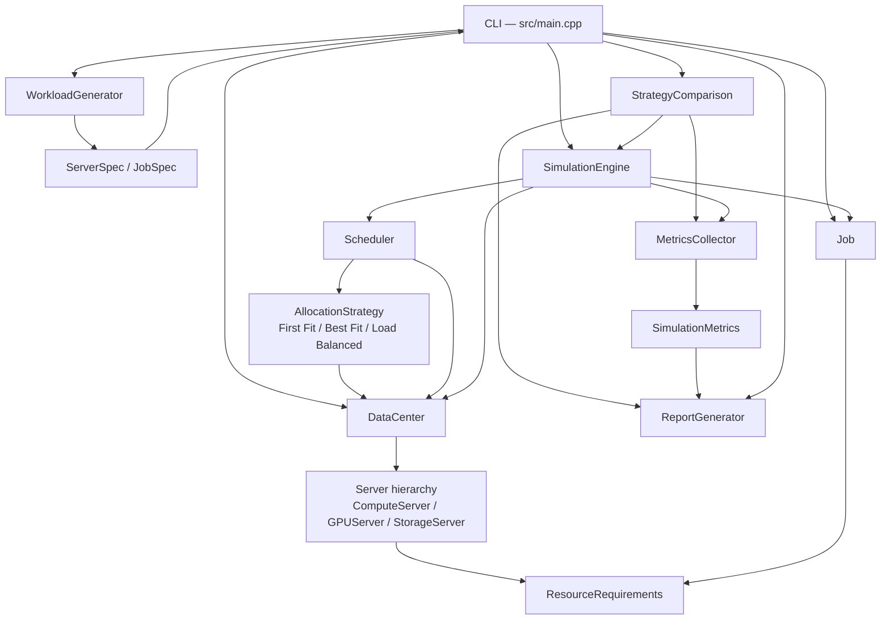

# Orchestrix

### A Discrete-Event Simulator for Adaptive Data-Center Resource Allocation

_**Orchestrix**_ is a C++17 command-line project developed for our Semester 3 Object-Oriented Programming with C++ course. It simulates job scheduling and resource allocation across heterogeneous data-center servers with different CPU, RAM, storage and GPU capacities. An integer-tick simulation clock drives arrivals, queueing, scheduling, execution and completion, then reports performance metrics for three allocation strategies.

---

## 1. Project Overview

Orchestrix models a small data center as a set of servers that own finite resources. Jobs arrive at known ticks, declare their resource requirements and duration, wait in a FIFO queue, and are placed on a compatible server by one of three allocation strategies. When a job finishes, its resources are released and become available to waiting jobs.

The simulator is deterministic for a given workload configuration and seed. The same job count, server count and seed always produce the same workload, so strategies can be compared fairly on identical input.

The project is intentionally a single-threaded, standard-library-only C++ application. It has no GUI, database, network layer or external runtime dependencies.

## 2. Features

- Domain model for jobs, resource requirements, and Compute, GPU and Storage servers.
- Atomic resource reservation and release with over-allocation and over-release protection.
- First Fit, Best Fit and Load Balanced allocation with deterministic tie-breaking.
- Integer-tick simulation with FIFO queueing, permanent rejection of impossible jobs and a tick-limit safeguard.
- Reproducible synthetic workload generation from `std::mt19937` using separate RNG streams for servers and jobs.
- Paginated results screen for single-strategy runs: 20 allocation records per page with `N` / `P` / `Q` navigation.
- Strategy comparison on an identical workload with fresh state for every run, plus a compact job-outcome summary table.
- Metrics for job outcomes, completion and rejection rates, average waiting time, throughput and resource-time utilization.
- Reconstructed server resource status display showing how available CPU, RAM, storage and GPU change during a run.
- Event-log filtering for job arrivals, starts, completions and rejections.
- Interactive ASCII command-line interface with 8 menu options and input validation.

## 3. Allocation Strategies

All strategies receive the same `DataCenter` and are asked to place a `Job`. A strategy only selects a server; the `Scheduler` performs the atomic resource reservation after selection.

| Strategy | Selection rule | Tie-breaking |
|---|---|---|
| **First Fit** | Iterate servers in data-center insertion order and choose the first server that is available, type-compatible and has enough available resources. | Insertion order — the first match wins. |
| **Best Fit** | For every compatible server, compute a score as the sum of `(available − required) / capacity` over each resource dimension the job requests. Choose the smallest score, i.e. the server that would be left with the least proportional free space. | Lexicographically smaller server ID. |
| **Load Balanced** | For every compatible server, compute the average projected utilization `(allocated + required) / capacity` over all dimensions with positive capacity. Choose the lowest projected utilization. | Lexicographically smaller server ID. |

A server is compatible only when it is available and its type accepts the job:

- `ComputeServer` accepts any workload that fits its capacity.
- `GPUServer` accepts only jobs with `gpu > 0`.
- `StorageServer` accepts only jobs with `storage > 0`.

A job that cannot fit on any compatible server at its arrival tick is rejected only if no server could ever hold it based on total capacity and type. Temporarily full servers do not cause permanent rejection; the job waits and is retried on later ticks.

## 4. Architecture



The engine advances one tick at a time and performs a fixed sequence:

1. Complete running jobs whose finish tick equals the current tick: release resources, log `RESOURCE_RELEASED`, then complete the job and log `JOB_COMPLETED`.
2. Process arrivals at this tick: move each job from `PENDING` to `QUEUED`, log `JOB_ARRIVED`, reject it if it can never fit, otherwise append it to the FIFO wait queue.
3. Scan the entire wait queue in FIFO order and try to schedule every job. Jobs that cannot be placed remain queued and are retried next tick; a blocked job does not prevent later jobs from being attempted.
4. Stop when all jobs are terminal, when no future events remain, or when the tick limit is reached.

`MetricsCollector` is stateless and reads the finished engine plus the data center. It reconstructs allocation intervals from `JOB_STARTED` and `RESOURCE_RELEASED` events. `ReportGenerator` is also stateless and formats all console output: paginated results, comparison reports, filtered event logs and server-status timelines.

## 5. Technology Stack

- **Language:** C++17 (no compiler-specific extensions)
- **Build system:** CMake 3.20 or newer
- **Generator:** Ninja (recommended) or any CMake generator
- **Testing:** CTest with self-contained C++ test executables
- **Libraries:** C++ standard library only
- **Warnings:** `/W4` on MSVC, `-Wall -Wextra -Wpedantic` elsewhere

The verified development toolchain is GCC 16.1.0 (MSYS2 UCRT64), CMake 4.3.3 and Ninja 1.13.2 on Windows.

## 6. Prerequisites and Installation

You need:

- A C++17 compiler (GCC, Clang or MSVC).
- CMake 3.20 or newer.
- Ninja is recommended but optional.
- Git to clone the repository.

On Windows, the verified setup uses the MSYS2 UCRT64 environment. Install the toolchain from an MSYS2 UCRT64 shell:

```bash
pacman -S --needed mingw-w64-ucrt-x86_64-gcc \
                   mingw-w64-ucrt-x86_64-cmake \
                   mingw-w64-ucrt-x86_64-ninja
```

Then clone the repository:

```bash
git clone https://github.com/Aaraghya/Orchestrix.git
cd Orchestrix
```

On Linux or macOS, install a C++17 compiler and CMake through your package manager; no project-specific dependencies are required.

## 7. Build Instructions

From the repository root in the MSYS2 UCRT64 shell:

```bash
cmake -S . -B build -G Ninja
cmake --build build
ctest --test-dir build --output-on-failure
```

The executable is produced at `build/orchestrix.exe` on Windows and `build/orchestrix` on POSIX systems. Omit `-G Ninja` to use the platform default generator.

From Windows PowerShell with explicit toolchain paths:

```powershell
C:\msys64\ucrt64\bin\cmake.exe -S . -B build -G Ninja
C:\msys64\ucrt64\bin\cmake.exe --build build
C:\msys64\ucrt64\bin\ctest.exe --test-dir build --output-on-failure
.\build\orchestrix.exe
```

To rebuild from scratch, remove the `build/` directory and run the configure step again.

## 9. Running Orchestrix

Start the interactive simulator:

```bash
./build/orchestrix.exe      # Windows
./build/orchestrix          # Linux / macOS
```

## 10. Contributing

1. Fork the repository and create a focused branch, for example `feature/my-change`.
2. Add or update tests for meaningful behavior and edge cases.
3. Build and run the full test suite locally.
4. Open a pull request describing the change, the motivation, and the tests run.

Please do not silently change agreed interfaces or simulation rules, and do not mix unrelated refactors into a single change. Keep changes focused and reviewable.

Acknowledgements:

- Developed as part of the Semester 3 **Object-Oriented Programming with C++** course.
- Built with the C++ standard library, CMake, CTest and Ninja.
- Reproducible demonstrations are documented in [docs/demo-scenarios.md](docs/demo-scenarios.md).
