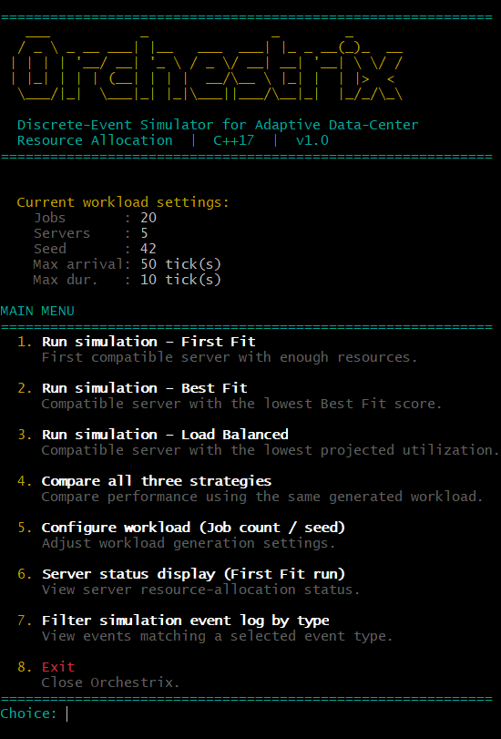
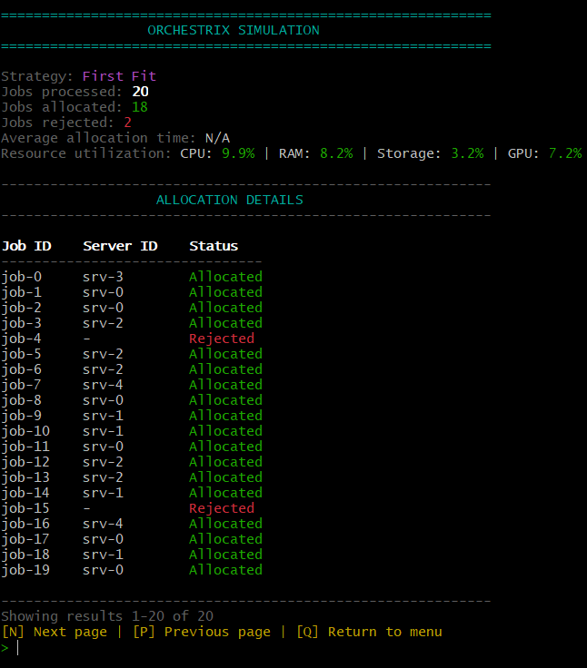
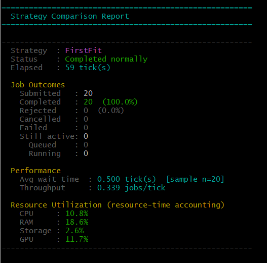
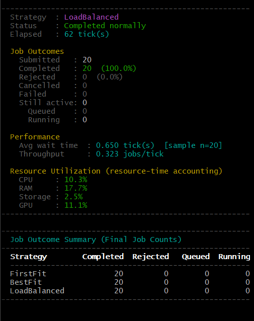
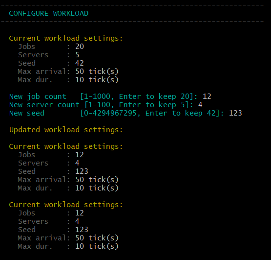
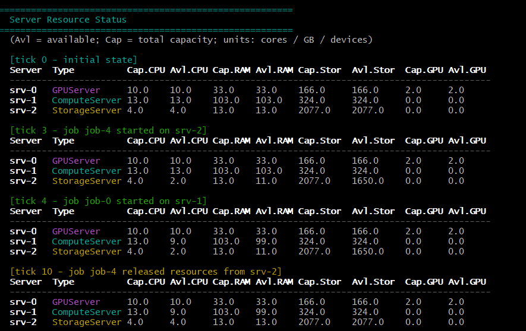
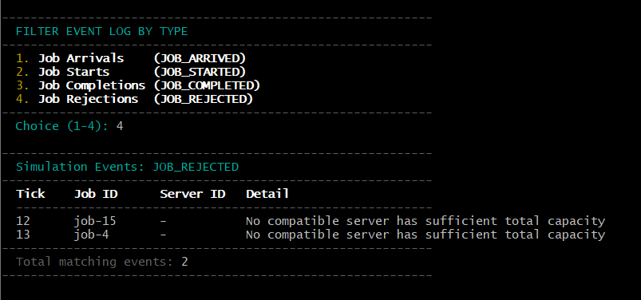
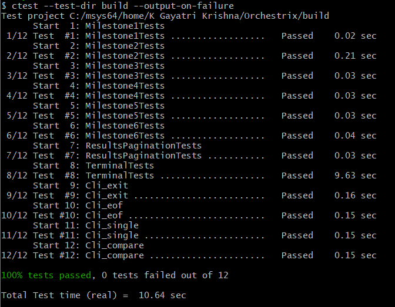
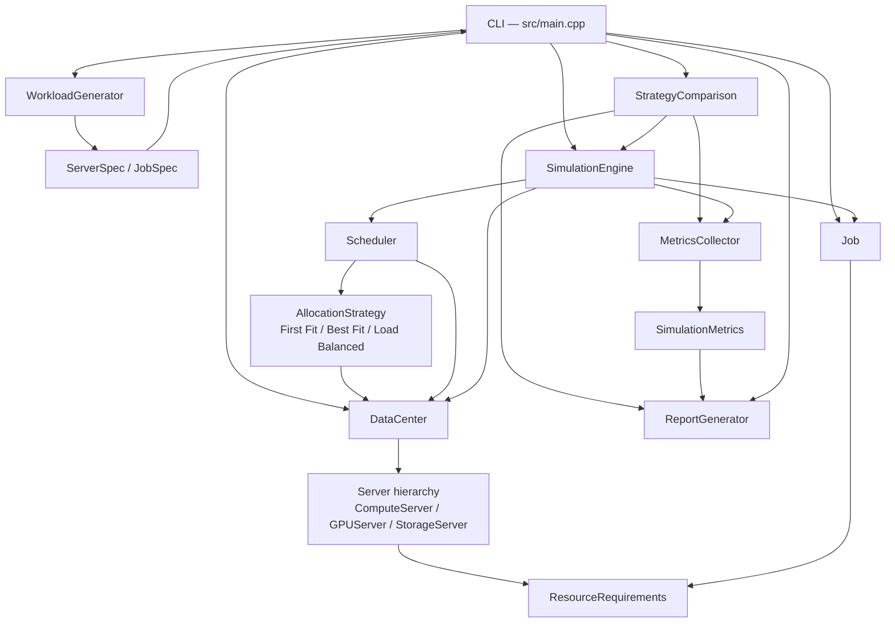

<div align="center">

# Orchestrix

### A Discrete-Event Simulator for Adaptive Data-Center Resource Allocation

`C++17`   `CMake`   `Ninja`   `CTest`   `Standard library only`   `Interactive CLI`

[Screenshots](#screenshots) / [Overview](#overview) / [Features](#features) / [Strategies](#allocation-strategies) / [How it works](#how-it-works) / [Getting started](#getting-started) / [Menu options](#menu-options) / [Team](#team)

</div>

***Orchestrix*** is a C++17 command-line project developed for our Semester 3 Object-Oriented Programming with C++ course (CSE 202, end-semester project). It simulates job scheduling and resource allocation across heterogeneous data-center servers with different CPU, RAM, storage and GPU capacities. An integer-tick simulation clock drives arrivals, queueing, scheduling, execution and completion, then reports performance metrics for three allocation strategies.

| | |
|---|---|
| [](screenshots/menu.png) | [](screenshots/single-run.png) |
| *The main menu* | *One strategy run, paginated, with job statuses colour-coded* |

---

## Screenshots

### Strategy comparison

Every strategy runs on the same generated workload with fresh state, then the report compares them.

| | |
|---|---|
| [](screenshots/comparison-top.png) | [](screenshots/comparison.png) |
| *Report header and the First Fit block* | *The last block and the final job outcome summary* |

### Configuring the workload

Choose the job count, server count and seed. The same seed always reproduces the same workload.

[](screenshots/configure.png)

### Server status over time

Shows how available CPU, RAM, storage and GPU change on each server as jobs start and finish.

[](screenshots/server-status.png)

### Event log filtering

Filter the simulation event log by event type, here showing only rejected jobs.

[](screenshots/event-log.png)

### Automated tests

[](screenshots/tests.png)

---

## Overview

Orchestrix models a small data center as a set of servers that own finite resources. Jobs arrive at known ticks, declare their resource requirements and duration, wait in a FIFO queue, and are placed on a compatible server by one of three allocation strategies. When a job finishes, its resources are released and become available to waiting jobs.

The simulator is deterministic for a given workload configuration and seed. The same job count, server count and seed always produce the same workload, so strategies can be compared fairly on identical input.

The project is intentionally a single-threaded, standard-library-only C++ application. It has no GUI, database, network layer or external runtime dependencies.

## Features

- **Domain model:** jobs, resource requirements, and Compute, GPU and Storage servers.
- **Safe resource accounting:** atomic reservation and release, with over-allocation and over-release protection.
- **Three allocation strategies:** First Fit, Best Fit and Load Balanced, with deterministic tie-breaking.
- **Discrete-event engine:** integer ticks, FIFO queueing, permanent rejection of impossible jobs and a tick-limit safeguard.
- **Reproducible workloads:** generated from `std::mt19937`, with separate RNG streams for servers and jobs.
- **Paginated results:** 20 allocation records per page, with `N` / `P` / `Q` navigation.
- **Fair strategy comparison:** the same workload and fresh state for every run, plus a compact job-outcome summary table.
- **Metrics:** job outcomes, completion and rejection rates, average waiting time, throughput and resource-time utilization.
- **Server status timeline:** reconstructs how available CPU, RAM, storage and GPU change during a run.
- **Event-log filtering:** job arrivals, starts, completions and rejections.
- **Colour-coded interactive CLI:** 8 menu options, input validation, and colour that switches off for piped output.

## Allocation Strategies

All strategies receive the same `DataCenter` and are asked to place a `Job`. A strategy only selects a server; the `Scheduler` performs the atomic resource reservation after selection.

| Strategy | Selection rule | Tie-breaking |
|---|---|---|
| **First Fit** | Walk the servers in insertion order and take the first one that is available, type-compatible and has enough free resources. | Insertion order: the first match wins. |
| **Best Fit** | Score each compatible server as the sum of `(available − required) / capacity` over the resources the job requests. The lowest score wins, meaning the server left with the least proportional free space. | Lexicographically smaller server ID. |
| **Load Balanced** | Compute each compatible server's average projected utilization `(allocated + required) / capacity` over every dimension with positive capacity. The lowest wins. | Lexicographically smaller server ID. |

A server is compatible only when it is available and its type accepts the job:

| Server type | Accepts |
|---|---|
| `ComputeServer` | Any workload that fits its capacity |
| `GPUServer` | Only jobs with `gpu > 0` |
| `StorageServer` | Only jobs with `storage > 0` |

A job that cannot fit on any compatible server at its arrival tick is rejected only if no server could ever hold it, judged by total capacity and type. A temporarily full server does not cause a permanent rejection: the job waits and is retried on later ticks.

### Example comparison

The same workload (20 jobs, 5 servers, seed 84) run through all three strategies:

| Metric | First Fit | Best Fit | Load Balanced |
|---|---:|---:|---:|
| Elapsed ticks | 59 | 59 | 62 |
| Completed / rejected | 20 / 0 | 20 / 0 | 20 / 0 |
| Average wait time | 0.500 | 0.250 | 0.650 |
| Throughput (jobs/tick) | 0.339 | 0.339 | 0.323 |

On this workload Best Fit had the shortest average wait and Load Balanced took the most ticks to finish. Other seeds and workloads can give different results, which is why the comparison mode exists.

## How it works

### Components

| Layer | Classes | Responsibility |
|---|---|---|
| Model | `ResourceRequirements`, `Job`, `Server`, `DataCenter` | Describe jobs, the four resource dimensions and the pool of servers |
| Servers | `ComputeServer`, `GPUServer`, `StorageServer` | Share one accounting base class and add their own compatibility rule |
| Strategies | `AllocationStrategy`, `FirstFit`, `BestFit`, `LoadBalanced` | Choose a server for a job; they never reserve resources themselves |
| Scheduling | `Scheduler` | Asks the strategy for a server, then reserves resources atomically |
| Simulation | `SimulationEngine`, `SimulationEvent`, `WorkloadGenerator` | Advance the tick clock, log events, generate reproducible workloads |
| Analysis | `MetricsCollector`, `SimulationMetrics`, `StrategyComparison` | Derive metrics from a finished run and compare strategies on identical input |
| Presentation | `ReportGenerator`, `Terminal.h`, `src/main.cpp` | Format every report, add colour, and run the interactive menu |

### Object-oriented design

| Concept | Where | How it is used |
|---|---|---|
| Encapsulation | `Server` | Owns its capacity and allocation. "Available" is computed as total minus allocated, and a failed reserve or release throws without changing anything. |
| Inheritance | `Server` → `ComputeServer`, `GPUServer`, `StorageServer` | Derived servers inherit all accounting and only add which jobs they accept. |
| Polymorphism | `AllocationStrategy` → `FirstFit`, `BestFit`, `LoadBalanced` | `Scheduler` calls `select()` through the base interface and never knows which strategy it holds. |
| Abstraction | `AllocationStrategy`, `Server::canRunJob()` | Pure virtual functions hide the selection and compatibility rules behind a small interface. |
| Separation of concerns | `MetricsCollector`, `ReportGenerator` | Stateless classes that derive or format results without touching simulation state. |

### Execution flow



The engine advances one tick at a time and performs a fixed sequence:

1. Complete running jobs whose finish tick equals the current tick: release resources, log `RESOURCE_RELEASED`, then complete the job and log `JOB_COMPLETED`.
2. Process arrivals at this tick: move each job from `PENDING` to `QUEUED`, log `JOB_ARRIVED`, reject it if it can never fit, otherwise append it to the FIFO wait queue.
3. Scan the entire wait queue in FIFO order and try to schedule every job. Jobs that cannot be placed remain queued and are retried next tick; a blocked job does not prevent later jobs from being attempted.
4. Stop when all jobs are terminal, when no future events remain, or when the tick limit is reached.

`MetricsCollector` is stateless and reads the finished engine plus the data center. It reconstructs allocation intervals from `JOB_STARTED` and `RESOURCE_RELEASED` events. `ReportGenerator` is also stateless and formats all console output: paginated results, comparison reports, filtered event logs and server-status timelines.

### Project structure

```
Orchestrix/
├── CMakeLists.txt          # build and test configuration
├── README.md
├── screenshots/            # images used in this README
├── docs/
│   ├── architecture.md     # components and execution flow
│   └── demo-scenarios.md   # reproducible demo walkthroughs
├── include/                # headers: model, strategies, engine, reports, Terminal.h
├── src/                    # implementations and main.cpp (the CLI)
└── tests/                  # milestone tests, pagination, terminal and CLI smoke tests
```

## Technology Stack

| | |
|---|---|
| **Language** | C++17, no compiler-specific extensions |
| **Build system** | CMake 3.20 or newer, with Ninja recommended |
| **Testing** | CTest with self-contained C++ test executables |
| **Libraries** | C++ standard library only |
| **Warnings** | `/W4` on MSVC, `-Wall -Wextra -Wpedantic` elsewhere |
| **Verified with** | GCC 13.3 on Ubuntu, and GCC 15.2 and 16.1 with CMake 4.x on Windows (MSYS2 UCRT64) |

## Getting started

### Prerequisites

- A C++17 compiler (GCC, Clang or MSVC)
- CMake 3.20 or newer
- Ninja (recommended, optional)
- Git

### Install and run

**Windows (MSYS2 UCRT64)**

1. Install [MSYS2](https://www.msys2.org) and open the **MSYS2 UCRT64** shell from the Start menu.
2. Install the toolchain:
   ```bash
   pacman -S --needed mingw-w64-ucrt-x86_64-gcc \
                      mingw-w64-ucrt-x86_64-cmake \
                      mingw-w64-ucrt-x86_64-ninja git
   ```
3. Clone the repository:
   ```bash
   git clone https://github.com/Aaraghya/Orchestrix.git
   cd Orchestrix
   ```
4. Build:
   ```bash
   cmake -S . -B build -G Ninja
   cmake --build build
   ```
5. Run:
   ```bash
   ./build/orchestrix.exe
   ```

**Linux and macOS**

Install a C++17 compiler, CMake, Ninja and Git with your package manager (for example `sudo apt install g++ cmake ninja-build git`), then:

```bash
git clone https://github.com/Aaraghya/Orchestrix.git
cd Orchestrix
cmake -S . -B build -G Ninja
cmake --build build
./build/orchestrix
```

Omit `-G Ninja` to use your platform's default generator. To rebuild from scratch, delete the `build/` directory and run the configure step again.

<details>
<summary>Windows PowerShell with explicit toolchain paths</summary>

```powershell
C:\msys64\ucrt64\bin\cmake.exe -S . -B build -G Ninja
C:\msys64\ucrt64\bin\cmake.exe --build build
C:\msys64\ucrt64\bin\ctest.exe --test-dir build --output-on-failure
.\build\orchestrix.exe
```

</details>

### Run the tests

```bash
ctest --test-dir build --output-on-failure
```

All tests should pass.

### Menu options

| Option | What it does |
|---|---|
| `1` | Run the simulation with **First Fit** and show paginated results |
| `2` | Run the simulation with **Best Fit** |
| `3` | Run the simulation with **Load Balanced** |
| `4` | Compare all three strategies on the same generated workload |
| `5` | Configure the workload: job count (1 to 1000), server count (1 to 100) and seed |
| `6` | Show the server status timeline for a First Fit run |
| `7` | Filter the event log by arrivals, starts, completions or rejections |
| `8` | Exit |

On the paginated screen, `N` shows the next page, `P` the previous page and `Q` returns to the menu. The default workload is 20 jobs, 5 servers and seed 42.

### Try it

Settings persist between menu choices, so each demo sets them first. Every demo is reproducible because the seed is fixed.

| Goal | Keys | What to notice |
|---|---|---|
| One strategy run | `1`, then `Q` | 18 jobs allocated, 2 rejected |
| Compare strategies | `5`, Enter, Enter, `84`, `4` | Different waiting times on the same workload |
| Overloaded data center | `5`, `50`, `1`, `42`, `4` | 11 completed, 39 rejected, GPU shown as `N/A` |
| Reproducibility | `5`, `12`, `4`, `123`, `1`, `Q` | 5 allocated, 7 rejected; rerun it for identical rows, then try seed `124` for 11 and 1 |
| Server status | `5`, `6`, `3`, `7`, `6` | Resources taken at each start and restored at each release |
| Event filtering | `5`, `20`, `5`, `42`, `7`, `4` | Two rejections: `job-15` at tick 12 and `job-4` at tick 13 |

More walkthroughs are in [docs/demo-scenarios.md](docs/demo-scenarios.md).

### Colour output

When Orchestrix runs in a terminal, the output is colour-coded: headings in cyan, `Allocated` / `Completed` in green, `Rejected` in red, `Queued` in yellow, utilization percentages from green to red, and the server types in their own colours. Colour is only added for interactive terminals, so piped output and the automated tests stay plain text.

| Setting | Effect |
|---|---|
| `NO_COLOR=1` | Turn colour off |
| `ORCHESTRIX_COLOR=always` | Force colour on (for example when the terminal is not detected) |
| `ORCHESTRIX_COLOR=never` | Turn colour off |

The colour logic lives in `include/Terminal.h` and is covered by `tests/test_terminal.cpp`.

### Troubleshooting

| Problem | Fix |
|---|---|
| On Windows, `ctest` reports `Process not started` | The new test programs were probably blocked while being scanned. Run `ctest --test-dir build --rerun-failed --output-on-failure`. |
| No colour appears | Run `ORCHESTRIX_COLOR=always ./build/orchestrix.exe`. |
| `cmd` or PowerShell cannot start `orchestrix.exe` because a DLL is missing | Start it from the UCRT64 shell, or add `C:\msys64\ucrt64\bin` to `PATH` in that window. |
| `pacman` reports download timeouts | Run the command again; it falls back to other mirrors. |

## Limitations

Orchestrix is a local simulation. These things are intentionally not part of the current build:

- A separate `ResourceManager` class (reservation and release live in the server operations)
- Server failure and recovery simulation, and job migration after failures
- CSV report export
- Manual job entry (the CLI uses generated workloads)
- Energy-aware scheduling
- Real cloud infrastructure integration or distributed execution
- A graphical user interface

The single-run results screen shows `Average allocation time` as `N/A`. Waiting time is reported in the strategy comparison instead.

## Team

Built for CSE 202 (Object-Oriented Programming with C++), Semester 3 end-semester project.

| Contributor | GitHub | Contributions |
|---|---|---|
| Aaraghya | [@Aaraghya](https://github.com/Aaraghya) | Project foundation and the core simulator: domain model, allocation strategies and scheduler, simulation engine, metrics collection, the CLI, and the architecture and demo documentation |
| gay3-dumb | [@gay3-dumb](https://github.com/gay3-dumb) | Event-log filtering, the job outcome summary table, the server status display, README updates for those menu options, and the colour-coded terminal output with its tests |
| ridhimaprasad5-gif | [@ridhimaprasad5-gif](https://github.com/ridhimaprasad5-gif) | Contextual explanations in the main menu and the paginated results display |

## Contributing

1. Create a focused branch, for example `feature/my-change`. Collaborators can push it directly; everyone else can fork the repository first.
2. Add or update tests for meaningful behavior and edge cases.
3. Build and run the full test suite locally.
4. Open a pull request describing the change, the motivation, and the tests run.

Please do not silently change agreed interfaces or simulation rules, and do not mix unrelated refactors into a single change. Keep changes focused and reviewable.

Acknowledgements:

- Developed as part of the Semester 3 **Object-Oriented Programming with C++** course.
- Built with the C++ standard library, CMake, CTest and Ninja.
- Reproducible demonstrations are documented in [docs/demo-scenarios.md](docs/demo-scenarios.md).
