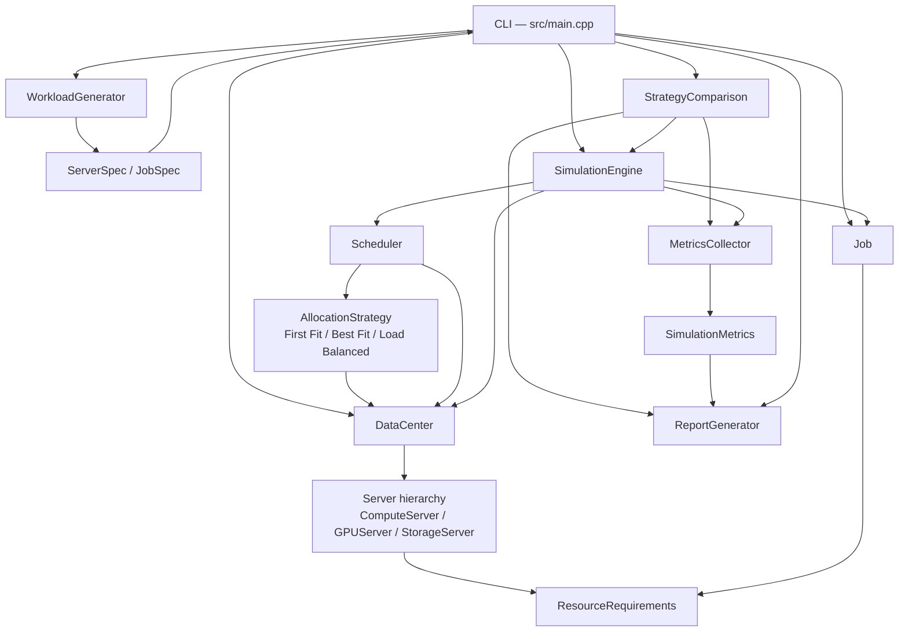

# Orchestrix

### A Discrete-Event Simulator for Adaptive Data-Center Resource Allocation

_**Orchestrix**_ is a C++17 command-line project developed for our Semester 3 Object-Oriented Programming with C++ course. It simulates job scheduling and resource allocation across heterogeneous data-center servers with different CPU, RAM, storage and GPU capacities. An integer-tick simulation clock drives arrivals, queueing, scheduling, execution and completion, then reports performance metrics for three allocation strategies.

---

## 1. Project Overview

Orchestrix models a small data center as a set of servers that own finite resources. Jobs arrive at known ticks, declare their resource requirements and duration, wait in a FIFO queue, and are placed on a compatible server by one of three allocation strategies. When a job finishes, its resources are released and become available to waiting jobs.

The simulator is deterministic for a given workload configuration and seed. The same job count, server count and seed always produce the same workload, so strategies can be compared fairly on identical input.

The project is intentionally a single-threaded, standard-library-only C++ application. It has no GUI, database, network layer or external runtime dependencies.

## 2. Features

- Domain model for jobs, resource requirements, and Compute, GPU and Storage servers.
- Atomic resource reservation and release with over-allocation and over-release protection.
- First Fit, Best Fit and Load Balanced allocation with deterministic tie-breaking.
- Integer-tick simulation with FIFO queueing, permanent rejection of impossible jobs and a tick-limit safeguard.
- Reproducible synthetic workload generation from `std::mt19937` using separate RNG streams for servers and jobs.
- Paginated results screen for single-strategy runs: 20 allocation records per page with `N` / `P` / `Q` navigation.
- Strategy comparison on an identical workload with fresh state for every run, plus a compact job-outcome summary table.
- Metrics for job outcomes, completion and rejection rates, average waiting time, throughput and resource-time utilization.
- Reconstructed server resource status display showing how available CPU, RAM, storage and GPU change during a run.
- Event-log filtering for job arrivals, starts, completions and rejections.
- Interactive ASCII command-line interface with 8 menu options and input validation.

## 3. Allocation Strategies

All strategies receive the same `DataCenter` and are asked to place a `Job`. A strategy only selects a server; the `Scheduler` performs the atomic resource reservation after selection.

| Strategy | Selection rule | Tie-breaking |
|---|---|---|
| **First Fit** | Iterate servers in data-center insertion order and choose the first server that is available, type-compatible and has enough available resources. | Insertion order — the first match wins. |
| **Best Fit** | For every compatible server, compute a score as the sum of `(available − required) / capacity` over each resource dimension the job requests. Choose the smallest score, i.e. the server that would be left with the least proportional free space. | Lexicographically smaller server ID. |
| **Load Balanced** | For every compatible server, compute the average projected utilization `(allocated + required) / capacity` over all dimensions with positive capacity. Choose the lowest projected utilization. | Lexicographically smaller server ID. |

A server is compatible only when it is available and its type accepts the job:

- `ComputeServer` accepts any workload that fits its capacity.
- `GPUServer` accepts only jobs with `gpu > 0`.
- `StorageServer` accepts only jobs with `storage > 0`.

A job that cannot fit on any compatible server at its arrival tick is rejected only if no server could ever hold it based on total capacity and type. Temporarily full servers do not cause permanent rejection; the job waits and is retried on later ticks.

## 4. Architecture



The engine advances one tick at a time and performs a fixed sequence:

1. Complete running jobs whose finish tick equals the current tick: release resources, log `RESOURCE_RELEASED`, then complete the job and log `JOB_COMPLETED`.
2. Process arrivals at this tick: move each job from `PENDING` to `QUEUED`, log `JOB_ARRIVED`, reject it if it can never fit, otherwise append it to the FIFO wait queue.
3. Scan the entire wait queue in FIFO order and try to schedule every job. Jobs that cannot be placed remain queued and are retried next tick; a blocked job does not prevent later jobs from being attempted.
4. Stop when all jobs are terminal, when no future events remain, or when the tick limit is reached.

`MetricsCollector` is stateless and reads the finished engine plus the data center. It reconstructs allocation intervals from `JOB_STARTED` and `RESOURCE_RELEASED` events. `ReportGenerator` is also stateless and formats all console output: paginated results, comparison reports, filtered event logs and server-status timelines.

## 5. Project Structure

```text
Orchestrix/
├── CMakeLists.txt              # Build, executable and CTest targets
├── README.md
├── docs/
│   ├── architecture.md         # Component design and responsibilities
│   └── demo-scenarios.md       # Reproducible CLI demonstrations
├── include/                    # Public headers
│   ├── AllocationStrategy.h
│   ├── DataCenter.h
│   ├── Job.h
│   ├── MetricsCollector.h
│   ├── ReportGenerator.h
│   ├── ResourceRequirements.h
│   ├── Scheduler.h
│   ├── Server.h
│   ├── SimulationEngine.h
│   ├── SimulationEvent.h
│   ├── SimulationMetrics.h
│   ├── StrategyComparison.h
│   └── WorkloadGenerator.h
├── src/                        # Implementation files
│   ├── AllocationStrategy.cpp
│   ├── DataCenter.cpp
│   ├── Job.cpp
│   ├── MetricsCollector.cpp
│   ├── ReportGenerator.cpp
│   ├── ResourceRequirements.cpp
│   ├── Scheduler.cpp
│   ├── Server.cpp
│   ├── SimulationEngine.cpp
│   ├── SimulationEvent.cpp
│   ├── StrategyComparison.cpp
│   ├── WorkloadGenerator.cpp
│   └── main.cpp                # Interactive CLI
└── tests/
    ├── cli_smoke_test.cmake    # Scripted CLI smoke tests
    ├── test_milestone1.cpp     # ResourceRequirements, Job, Server, DataCenter
    ├── test_milestone2.cpp     # Allocation strategies and Scheduler
    ├── test_milestone3.cpp     # Simulation engine, queueing and event log
    ├── test_milestone4.cpp     # Metrics and reporting
    ├── test_milestone5.cpp     # Workload generation and strategy comparison
    ├── test_milestone6.cpp     # Integration and edge cases
    └── test_results_pagination.cpp
```

## 6. Technology Stack

- **Language:** C++17 (no compiler-specific extensions)
- **Build system:** CMake 3.20 or newer
- **Generator:** Ninja (recommended) or any CMake generator
- **Testing:** CTest with self-contained C++ test executables
- **Libraries:** C++ standard library only
- **Warnings:** `/W4` on MSVC, `-Wall -Wextra -Wpedantic` elsewhere

The verified development toolchain is GCC 16.1.0 (MSYS2 UCRT64), CMake 4.3.3 and Ninja 1.13.2 on Windows.

## 7. Prerequisites and Installation

You need:

- A C++17 compiler (GCC, Clang or MSVC).
- CMake 3.20 or newer.
- Ninja is recommended but optional.
- Git to clone the repository.

On Windows, the verified setup uses the MSYS2 UCRT64 environment. Install the toolchain from an MSYS2 UCRT64 shell:

```bash
pacman -S --needed mingw-w64-ucrt-x86_64-gcc \
                   mingw-w64-ucrt-x86_64-cmake \
                   mingw-w64-ucrt-x86_64-ninja
```

Then clone the repository:

```bash
git clone https://github.com/Aaraghya/Orchestrix.git
cd Orchestrix
```

On Linux or macOS, install a C++17 compiler and CMake through your package manager; no project-specific dependencies are required.

## 8. Build Instructions

From the repository root in the MSYS2 UCRT64 shell:

```bash
cmake -S . -B build -G Ninja
cmake --build build
ctest --test-dir build --output-on-failure
```

The executable is produced at `build/orchestrix.exe` on Windows and `build/orchestrix` on POSIX systems. Omit `-G Ninja` to use the platform default generator.

From Windows PowerShell with explicit toolchain paths:

```powershell
C:\msys64\ucrt64\bin\cmake.exe -S . -B build -G Ninja
C:\msys64\ucrt64\bin\cmake.exe --build build
C:\msys64\ucrt64\bin\ctest.exe --test-dir build --output-on-failure
.\build\orchestrix.exe
```

To rebuild from scratch, remove the `build/` directory and run the configure step again.

## 9. Running Orchestrix

Start the interactive simulator:

```bash
./build/orchestrix.exe      # Windows
./build/orchestrix          # Linux / macOS
```

The current workload settings are printed before every menu, followed by the 8 options:

```text
  1. Run simulation - First Fit
     First compatible server with enough resources.

  2. Run simulation - Best Fit
     Compatible server with the lowest Best Fit score.

  3. Run simulation - Load Balanced
     Compatible server with the lowest projected utilization.

  4. Compare all three strategies
     Compare performance using the same generated workload.

  5. Configure workload (Job count / seed)
     Adjust workload generation settings.

  6. Exit
     Close Orchestrix.

  7. Server status display (First Fit run)
     View server resource-allocation status.

  8. Filter simulation event log by type
     View events matching a selected event type.
```

| Option | Behavior |
|---|---|
| **1** | Generates a fresh workload, runs First Fit, then opens the paginated results screen. |
| **2** | Generates a fresh workload, runs Best Fit, then opens the paginated results screen. |
| **3** | Generates a fresh workload, runs Load Balanced, then opens the paginated results screen. |
| **4** | Generates one workload and runs all three strategies on identical specs with fresh state for each. Prints a full report per strategy and a compact job-outcome summary table. |
| **5** | Configures job count, server count and seed. Pressing Enter or entering an invalid value keeps the current setting. |
| **6** | Exits the simulator. End-of-input is also treated as an exit. |
| **7** | Generates a workload, runs First Fit, and prints the server resource-status timeline. |
| **8** | Generates a workload, runs First Fit, then filters the event log by one of four job event types. |

### Paginated results screen (Options 1–3)

Results are shown 20 records per page:

- **`N`** — next page
- **`P`** — previous page
- **`Q`** — return to the main menu

The screen shows the strategy name, jobs processed, jobs allocated, jobs rejected, average allocation time, resource utilization, and allocation details for each job. Entering an unknown command prints a hint; pressing `N` on the final page or `P` on the first page prints a boundary message.

### Event filtering (Option 8)

After the run, choose one of:

1. Job arrivals (`JOB_ARRIVED`)
2. Job starts (`JOB_STARTED`)
3. Job completions (`JOB_COMPLETED`)
4. Job rejections (`JOB_REJECTED`)

The choice may also be entered as `arrival`, `start`, `completion`, `rejection`, or the exact enum name.

## 10. Workload Configuration

Default workload settings:

| Setting | Default | CLI range |
|---|---|---|
| Job count | 20 | 1–1000 |
| Server count | 5 | 1–100 |
| Random seed | 42 | 0–4294967295 |
| Maximum arrival tick | 50 | Not exposed by the CLI |
| Maximum job duration | 10 | Not exposed by the CLI |

Option 5 updates only the first three settings in the current session; all other values remain at their defaults. A workload is regenerated from the current settings every time an option runs, so changing the seed or counts affects the next run immediately.

### Generated server bounds

| Server kind | CPU | RAM (GB) | Storage (GB) | GPU |
|---|---|---|---|---|
| `ComputeServer` | 8–32 | 16–128 | 200–1000 | 0 |
| `GPUServer` | 8–16 | 16–64 | 50–200 | 2–8 |
| `StorageServer` | 4–8 | 8–32 | 500–5000 | 0 |

The server mix is at least 60% compute, with the remainder split roughly evenly between GPU and storage servers.

### Generated job bounds

| Field | Range |
|---|---|
| CPU | 0–8 (0 means not required) |
| RAM | 0–32 GB |
| Storage | 0–500 GB |
| GPU | 0–2 (0 means not required) |
| Arrival tick | 0–50 |
| Duration | 1–10 ticks |
| Priority | 0–9 |

At least one resource dimension is positive for every generated job. Jobs are drawn from CPU-bound, GPU-bound, storage-bound and hybrid mixes so that workloads exercise all server types.

Reproducibility is exact: the same job count, server count, seed and generation bounds produce the same servers and jobs. Server generation and job generation use separate domain-tagged `std::mt19937` streams, so changing one part of the workload does not shift the other.

## 11. Simulation Results and Metrics

### Single-strategy results screen (Options 1–3)

- **Jobs processed** — total jobs submitted.
- **Jobs allocated** — completed jobs plus jobs still running.
- **Jobs rejected** — jobs permanently unable to fit.
- **Average allocation time** — currently displayed as `N/A`; this field is a placeholder and no allocation-time value is computed for this screen.
- **Resource utilization** — CPU, RAM, storage and GPU utilization produced by `MetricsCollector`.
- **Allocation details** — one row per job with job ID, assigned server ID and status: `Allocated`, `Running`, `Rejected`, `Queued`, `Pending`, `Cancelled` or `Failed`. Jobs without an assigned server show `-`.

### Full metrics (Option 4 and library API)

Each strategy report in Option 4 includes:

- **Status** — completed normally, stopped at the max-tick limit, or stopped.
- **Elapsed ticks** — the final simulation tick.
- **Job outcomes** — submitted, completed, rejected, cancelled, failed, and still active with queued/running breakdown.
- **Average waiting time** — mean of `startTick − arrivalTick` over jobs that started, with the sample count `n`. It is `N/A` when no job started.
- **Throughput** — `completed / elapsedTicks` jobs per tick; `N/A` when elapsed ticks is zero.
- **Resource-time utilization** — for each dimension, the sum of `requirement × execution duration` for started jobs divided by the sum of `capacity × elapsedTicks` across all servers. Each dimension is `N/A` when its denominator is zero.

Completion and rejection rates use total submitted jobs as the denominator and are printed as percentages.

Resource-time utilization is an average over the whole run, not an instantaneous snapshot. Jobs still running when the simulation stops contribute up to the stop tick. The `Job` model also exposes `CANCELLED` and `FAILED` states, but the current CLI has no path that triggers cancellation or failure; they appear as zero in normal runs.

### Strategy comparison (Option 4)

Option 4 builds one server/job specification set and runs First Fit, Best Fit and Load Balanced independently. Each run gets a fresh `DataCenter`, fresh `Job` objects and a fresh engine, so resource state never leaks between strategies. The output contains a full report for each strategy and a final summary with columns for completed, rejected, queued and running jobs.

## 12. Event Logs and Server Status

The engine records these event types:

| Event | Meaning |
|---|---|
| `SIM_STARTED` | The simulation run began. |
| `JOB_ARRIVED` | A job reached its arrival tick and became queued. |
| `JOB_REJECTED` | A job can never fit on any compatible server. |
| `JOB_STARTED` | A job was allocated to a server and started running. |
| `JOB_COMPLETED` | A job finished execution. |
| `JOB_FAILED` | A job was marked failed (supported by the model; no simulator path triggers it). |
| `JOB_CANCELLED` | A job was cancelled (supported by the model; no simulator path triggers it). |
| `RESOURCE_RELEASED` | A server released the resources of a completed job. |
| `SIM_FINISHED` | The simulation ended normally, including early termination when no future events remain. |
| `SIM_MAX_TICK` | The simulation stopped because the tick limit was reached. |

Each event stores a tick, type, optional job ID, optional server ID and a detail string. Option 8 filters the four job events listed above and prints matching rows plus a total count; it prints `(No matching events found)` when nothing matches.

Option 7 reconstructs server status rather than reading a live server snapshot:

1. Start from tick 0 with every server at full capacity.
2. Replay `JOB_STARTED` events in log order, subtracting each job's requirements from its server.
3. Replay `RESOURCE_RELEASED` events in log order, adding the requirements back.
4. Print the full server table after every change.

The table shows server ID, type, total capacity and available CPU, RAM, storage and GPU. Because the CLI runs a fresh First Fit simulation for this option, the timeline always corresponds to that run, not to an earlier menu action.

## 13. Testing

Run the complete suite with:

```bash
ctest --test-dir build --output-on-failure
```

The suite contains 11 CTest entries: 7 self-contained unit-test executables and 4 scripted CLI smoke tests.

| Test executable | CTest name | Tests |
|---|---|---|
| `test_milestone1` | `Milestone1Tests` | 52 |
| `test_milestone2` | `Milestone2Tests` | 37 |
| `test_milestone3` | `Milestone3Tests` | 26 |
| `test_milestone4` | `Milestone4Tests` | 36 |
| `test_milestone5` | `Milestone5Tests` | 43 |
| `test_milestone6` | `Milestone6Tests` | 18 |
| `test_results_pagination` | `ResultsPaginationTests` | 12 |
| **Unit tests total** | | **224** |

The CLI smoke tests are `Cli_exit`, `Cli_eof`, `Cli_single` and `Cli_compare`. They drive the real executable with scripted standard input and verify the exit status plus an expected output marker. The unit tests use a small self-contained harness; no external test framework is required.

Last verified state: **11/11 CTest entries passed, 0 failed** (224 unit tests plus 4 CLI smoke tests).

## 14. Example Usage

A default First Fit run uses 20 jobs, 5 servers and seed 42. Select option `1`, then press `Q` to return to the menu:

```text
Choice: 1

  Running FirstFit on 20 job(s) / 5 server(s)  [seed=42] ...

============================================================
                  ORCHESTRIX SIMULATION
============================================================

Strategy: First Fit
Jobs processed: 20
Jobs allocated: 18
Jobs rejected: 2
Average allocation time: N/A
Resource utilization: CPU: 9.9% | RAM: 8.2% | Storage: 3.2% | GPU: 7.2%

------------------------------------------------------------
                   ALLOCATION DETAILS
------------------------------------------------------------

Job ID    Server ID    Status
--------------------------------
...
------------------------------------------------------------
Showing results 1–20 of 20
[N] Next page | [P] Previous page | [Q] Return to menu
> Q
```

The same default workload produces two rejection events. Selecting option `8`, then `4`, shows:

```text
  Simulation Events: JOB_REJECTED
------------------------------------------------------------
  Tick    Job ID      Server ID   Detail
  ----------------------------------------------------------
  12      job-15      -           No compatible server has sufficient total capacity
  13      job-4       -           No compatible server has sufficient total capacity
------------------------------------------------------------
  Total matching events: 2
------------------------------------------------------------
```

To demonstrate constrained resources, use option `5` to set 50 jobs and 1 server (seed 42), then run First Fit. The single server cannot absorb most arrivals, so the run ends with 11 completed jobs and 39 rejections. The per-strategy reports and additional walkthroughs are documented in [docs/demo-scenarios.md](docs/demo-scenarios.md).

## 15. Design Decisions and Limitations

**Design decisions**

- Resource requirements are plain value objects with four dimensions; a server's available capacity is derived as `capacity − allocated`, avoiding duplicated state.
- Reservation and release are atomic: all checks run before any counter changes, and releasing more than is allocated is rejected.
- Permanent rejection uses total capacity and server type, not current availability, so temporary congestion does not discard feasible jobs.
- Scheduling scans the whole FIFO queue each tick, which prevents one large blocked job from stalling every job behind it.
- Workload generation uses separate RNG streams for servers and jobs so each can change independently while remaining reproducible.
- Reporting is separated from simulation: the engine only records events, while `MetricsCollector` and `ReportGenerator` derive all numbers and text.

**Known limitations**

- The queue policy is FIFO. Job priority is stored and validated but is not yet used for ordering.
- Jobs are non-preemptive and always run to completion once started.
- The CLI exposes job count, server count and seed only; arrival spread and duration bounds are fixed at 50 and 10.
- Failure injection, server availability changes and energy-aware scheduling are not implemented. `Server::setAvailable()` and the `CANCELLED` / `FAILED` job transitions exist in the model but are not reachable through the simulator or CLI.
- Reports are printed to the console only. There is no CSV, JSON or file export, and no persistence between runs.
- The paginated screen's "Average allocation time" field is a placeholder that always shows `N/A`.
- Server status is reconstructed post-run from events, so it reflects event boundaries rather than arbitrary intermediate ticks.
- The only safeguard against pathological runs is a global 100,000-tick limit chosen by the CLI.

## 16. Future Improvements

- Use job priority in queue ordering, then expose a priority-aware strategy.
- Add configurable arrival spread and duration bounds to workload configuration.
- Add explicit failure and recovery scenarios that use the existing `FAILED` state and server availability controls.
- Add preemption or rescheduling policies for long-running jobs.
- Export metrics and allocation records to CSV or JSON for external analysis.
- Add more allocation strategies and a configurable strategy-selection menu.
- Extend server-status output to arbitrary ticks and summarize peak utilization.
- Add energy-aware scheduling as an optional strategy.

## 17. Contributing

1. Fork the repository and create a focused branch, for example `feature/my-change`.
2. Read the existing headers and [docs/architecture.md](docs/architecture.md) before changing behavior.
3. Keep the architecture modular and the code readable for a second-year CSE student.
4. Add or update tests for meaningful behavior and edge cases.
5. Build and run the full test suite locally.
6. Open a pull request describing the change, the motivation and the tests run.

Please do not silently change agreed interfaces or simulation rules, and do not mix unrelated refactors into a single change. Keep changes focused and reviewable.

## 18. License and Acknowledgements

This repository does not currently contain a `LICENSE` file, so no open-source license is granted by default. The authors retain their rights; please contact them before redistributing or reusing the code outside this coursework.

Acknowledgements:

- Developed as part of the Semester 3 **Object-Oriented Programming with C++** course.
- Built with the C++ standard library, CMake, CTest and Ninja.
- Component design and reproducible demonstrations are documented in [docs/architecture.md](docs/architecture.md) and [docs/demo-scenarios.md](docs/demo-scenarios.md).
